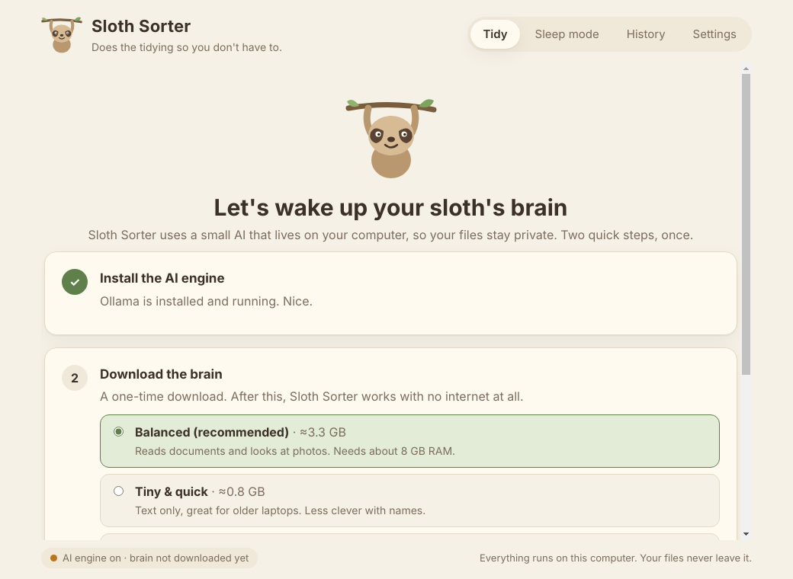

*This is my submission for the "Slow and Steady" challenge.*

## What I built

My Downloads folder is a crime scene. `scan0001.pdf`. `IMG_2231.png`. `final_FINAL_v2.docx`. Forty installers I will never open again.

**Sloth Sorter** is a desktop app for people who are never going to open a terminal. You install it like any other app, point it at a messy folder, and a small AI model running *on your own computer* reads your files, works out what each one is, and proposes a tidy-up:

- `scan0001.pdf` → `Bills & Receipts / 2026-09-14 Electricity Invoice.pdf`
- `IMG_2231.png` → `Photos / Dog on Beach at Sunset.png`
- `Screenshot 2026-10-01 at 10.00.png` → `Screenshots /`

You review the plan (rename anything, untick anything), press one button, and it's done. Don't like it? **Undo** puts every file back.

Then comes the laziest part: **Sleep mode**. Flip a switch and it quietly tidies the folder in the background, forever, with every batch logged and undoable.

## How a non-technical person gets started

The whole point was "install it and it just works", so there is a guided first run: a two-step wizard that detects whether the free open-source engine ([Ollama](https://ollama.com)) is installed, wakes it up if it's asleep, and downloads the model with a progress bar. No command line anywhere. After that it works with no internet at all.

## Why open models matter for this one

A file tidier has to read the *inside* of your files, and the files in a Downloads folder are the ones you least want to upload: invoices, lease letters, tax documents, photos.

1. **Privacy by construction.** There is no server to trust because there is no server. The default model (Gemma 3 4B) reads PDF text and even looks at photos locally.
2. **It works offline.** On a train, on a plane, wherever.
3. **It's free forever.** No API key, no quota. Sleep mode might classify thousands of files over a year; with a hosted API that's a recurring bill and a privacy policy to read. Here it's a bit of electricity.
4. **I can swap the brain.** Settings lets you pick any model in the Ollama library. Tiny one for an old laptop, bigger one for better names. When a better small model ships, it's one dropdown, not a migration.
5. **Structured output makes small models dependable.** Ollama can constrain generation to a JSON schema. I give the model an `enum` of the user's own folder names, so even a 4B model cannot invent a category or break the format. That one feature is what makes a small local model good enough for a job I would normally hand to a frontier API.

## Where open worked better than closed

Honestly: a big hosted model would write slightly nicer file names. But for "is this an electricity bill or a lecture note?" a small open model is *good enough*, and everything around it is better: no key to paste in, no per-file cost, no consent question every time a file is read, no outage, and it keeps working on a plane. For software meant to run unattended in the background on someone's personal files, those properties matter more than a marginally smarter title.

## Designed so laziness is safe

Giving an AI the power to move your files is only OK if the worst case is boring. So:

- **It never deletes and never overwrites.** Name clashes become `Report (2).pdf`.
- **Plan first.** Nothing moves until you press the button.
- **Everything is undoable**, including automatic Sleep mode batches, via a JSON journal.
- **It stays in its lane.** Only top-level files in the chosen folder; skips subfolders, hidden files, shortcuts, and anything still downloading. Sleep mode only touches files untouched for a few minutes.
- **It degrades gracefully.** If the model is missing or errors on a file, that file is sorted by type instead. The app is never useless.
- Model output is treated as untrusted: names are sanitised for Windows/macOS/Linux, and a category like `../../etc` cannot escape the `Sorted` folder (there's a test for that).

## Under the hood

Electron + vanilla JS (no build step, no CDN, so the UI works offline), talking to Ollama's local HTTP API over plain `fetch`. Under 2,000 lines including the CSS. The core (`src/core/`) is plain Node with no Electron imports, which let me test the whole pipeline (plan, apply, undo, collisions, injection, fallbacks) against a **mock Ollama server** speaking the same API, so the 12 tests run in a second with no 3 GB download. A GitHub Actions workflow builds the Windows `.exe` and macOS `.dmg` installers when I push a tag.

Pipeline per file: extract a snippet locally (PDF/DOCX/text, or a downsized image for vision models) → one schema-constrained chat call returning `{summary, category, title, date}` → sanitise → plan.

## Honest limitations

- The installers aren't code-signed yet, so Windows/macOS show a one-time "unknown developer" warning (the README walks through it).
- Ollama is a separate free install rather than bundled; the models are gigabytes, so the wizard guides the download instead.
- Only PDF, DOCX, text/code and images are *read*; other formats are judged by name and type.

## Try it

- Code and installers: **[link to your repo / releases here]**
- From source: `npm install && npm start`

Happy International Sloth Day. It's the one day it's fine for the computer to do the work. 🦥
