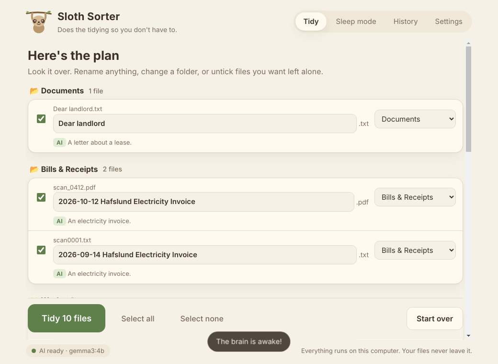

# Sloth Sorter

**A lazy, private file tidier. An AI that lives on your computer reads your messy folder, renames the cryptic files, sorts everything into sensible folders, and lets you undo it all with one click.**

No account. No subscription. No internet needed after setup. Your files never leave your computer.



## For everyone: install it

1. Go to the **Releases** page and download the installer for your computer:
   - **Windows:** `Sloth-Sorter-…-win-x64.exe`
   - **Mac:** `Sloth-Sorter-…-mac-arm64.dmg` (Apple chip, 2020 and newer) or `…-mac-x64.dmg` (Intel)
2. Open it. The first time, your computer may warn that the app is from an "unidentified developer" because it isn't code-signed yet:
   - **Windows:** click **More info → Run anyway**.
   - **Mac:** drag it to Applications, then **right-click → Open → Open**.
3. Follow the two friendly setup steps inside the app (install the free **Ollama** engine, then download the "brain"). It takes about five minutes, once.
4. Pick a folder, press **Take a look**, check the plan, press **Tidy**.

That's it. Made a mistake? **History → Undo**.

### Go full sloth: Sleep mode
Switch on **Sleep mode** and Sloth Sorter quietly tidies your Downloads folder in the background, only touching files you haven't used for a few minutes. Close the window; it keeps sleeping in your tray / menu bar.

## What it will and won't do

| It does | It never |
|---|---|
| Read the text inside PDFs, Word files, notes and more to work out what they are | Deletes anything |
| Look at photos (with the default model) | Overwrites a file (name clashes get a `(2)`) |
| Suggest readable names, e.g. `2026-09-14 Electricity Invoice.pdf` | Touches subfolders, hidden files or half-finished downloads |
| Show you a plan first, where you can edit names and folders | Sends a single byte to the internet |
| Keep a full undo history | Changes a file's extension |

If the AI isn't available for any reason, it falls back to plain sorting by file type, so it's never useless.

## Why open models?

A file tidier has to *read your files*: invoices, lease letters, tax papers. That is exactly what you shouldn't upload to someone else's server. Running an open-weight model locally means:

- **Private by construction.** There's no server to trust, because there is no server.
- **Works offline.** On a plane, on a train, in a cabin.
- **Free forever.** No API key, no per-file bill, no quota. Sleep mode can classify thousands of files for the cost of a little electricity.
- **Swappable.** Pick any model in the Ollama library from *Settings*. A better small model ships next month? Change one setting.
- **Reliable even when small.** Ollama's structured output constrains the model to a JSON schema (folder = one of *your* folders), so a 4B model can't ramble or invent categories.

## For developers

```bash
git clone https://github.com/Brage1025/sloth-sorter
cd sloth-sorter
npm install
npm start          # run the app
npm test           # 28 tests, no Ollama needed (uses a mock server)
npm run dist       # build an installer for your current OS into ./dist
```

Every push and pull request runs the tests on Windows, macOS and Linux. See [CONTRIBUTING.md](CONTRIBUTING.md) and the [changelog](CHANGELOG.md).

Release installers for Windows, macOS and Linux are built by GitHub Actions: push a tag like `v1.0.0` and the workflow attaches them to a Release.

**Architecture** (three runtime dependencies: mammoth, pdf-parse, pdfjs-dist):

```
src/core/       plain Node, no Electron: easy to test
  ollama.js     tiny client: status, pull (streaming), chat with JSON-schema output
  extract.js    PDF / DOCX / text / image snippets, all local
  classify.js   prompt + schema -> {summary, category, title, date}; falls back to rules
  rules.js      the no-AI fallback (by file type)
  naming.js     cross-platform-safe names, "is this name cryptic?" heuristic
  planner.js    scan -> plan -> apply -> undo; never overwrites, never leaves the folder
  history.js    JSON undo journal
  watcher.js    Sleep mode loop
src/main.js     Electron main process, IPC, tray
src/renderer/   vanilla HTML/CSS/JS UI (no build step, no CDN: works offline)
test/           node:test suite + a mock Ollama server
```

Configure for development without installing Ollama:

```bash
node test/mock-ollama.js 11500 &
SLOTH_OLLAMA_HOST=http://127.0.0.1:11500 SLOTH_FOLDER=/some/messy/dir npm start
```

## Troubleshooting

- **"Electron failed to install correctly"**: newer npm versions block install scripts by default, so Electron's binary never downloads. Run `node node_modules/electron/install.js` once (`npm start` now does this automatically).

## What it can't do yet

Honest limits, so nothing surprises you.

**Speed**
- It runs the AI on your own computer, so speed depends on your hardware. On a computer without a supported graphics card, expect roughly 20 seconds per text file and about a minute per photo. A folder of 18 mixed files took around 15 minutes in testing. With a graphics card it is much faster.
- Ways to cut the wait: turn off **Look at photos** in Settings (photos are then sorted by name and type), use a smaller model, or switch on Sleep mode and let it work in the background.
- Files it has seen before are remembered, so a second scan of an unchanged folder is quick. **Settings, Forget what I've learned** clears that memory.

**Reading files**
- It reads PDF, DOCX, plain text and code, and images. PowerPoint, Excel and other formats are judged by file name and type only.
- Scanned PDFs (pages that are pictures) are read by looking at the first page, which needs a model that can see and takes longer. With **Look at photos** off, they are sorted by file type.
- Photos and scans are never used to pick a date for the file name, because a small model misreads digits. Dates come only from text in the document.
- A small model can still get a name wrong, especially for documents that never state what they are about. That is why you always see a plan first and can edit any name or folder.

**Scope**
- Only the top level of the chosen folder is tidied. Subfolders are left alone, by design.
- English works best. Other languages work, but with less accuracy on small models.
- Installers are unsigned (code-signing certificates cost money), so expect the one-time warning described above.
- Ollama is a separate free install rather than bundled. The models are gigabytes, so the app guides you through it instead of shipping a 3 GB installer.

**Testing**
- The automated tests use a mock of Ollama, not a real model, so they check the app's logic and safety rules but not the AI's judgement. The AI's quality was checked by hand on real files.
- The Windows and Linux builds have been run by hand. The macOS build is built and tested by CI but has had little hands-on testing, particularly the menu bar icon and the first-run security prompt.

## License

MIT. Models are subject to their own licenses (e.g. Gemma's terms).
